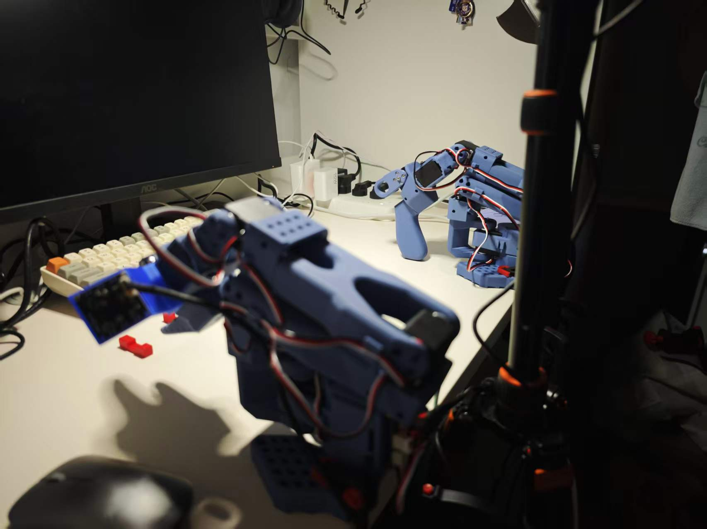
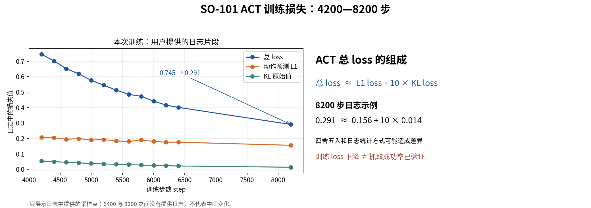

# SO-101 采集、回放、打包、训练与本地推理全流程

> 2026-11-11：从臂 3 号在支架支撑下仍无明显跟随，正等待飞特调试平台检查。**先排除故障，再做实机校准、跟随和采集**。脚本及模拟验证完成，不代表真实采集已经验收通过。事故保护文件如存在，必须先按记录处理，不能删除文件来绕过保护。

## 1. 一条命令进入

在采集笔记本图形桌面的终端运行：

```bash
bash "$HOME/so-ARM101机械臂/scripts/lerobot/interactive_collection.sh"
```
or

```bash
sg dialout -c 'sg video -c "bash \"$HOME/so-ARM101机械臂/scripts/lerobot/interactive_collection.sh\""'
```
它会在未激活时加载本机 LeRobot v0.6.1 环境，并读取 `scripts/lerobot/fms688.env`。菜单显示任务、版本、轮次、目标条数和数据路径。退出菜单选 `0`；脚本在子进程中激活环境，退出后不会修改当前终端的环境。

本机数据根目录为 `~/fms688_data`，目前指向 E 盘。先通过文件管理器挂载 E 盘；可以在另一个终端核对：

```bash
findmnt -T "$HOME/fms688_data" -o TARGET,SOURCE,FSTYPE,AVAIL
```

采集到本机 SSD，勿直接写到网络共享盘。预检空间阈值只是下限；图像保存在 Parquet 中，先用短样本测算实际每条所需空间。

## 2. 设备检查与标定

1. 菜单选 **10**，列出串口和相机设备；稳定串口以 `/dev/serial/by-id/` 为准。此前现场确认：手动主臂序列号 `5B90148801`，从臂 `5B91028773`；顶部是 1080P 相机，腕部是 H-720P。拔插或换线后要重新核对，设备列表本身不能证明线接对。
2. 菜单选 **1**，检查环境、权限、端口、相机和空间。预检不发电机运动命令。若首次尚无校准文件，此步可能提示失败；设备核对后可先完成下一步校准，再重跑预检。两路摄像头应接到带宽足够的独立 USB 接口。
3. 若校准已经正确且机械装配没有改变，可保留现有校准。首次校准或确需重新校准时，故障排除后选 **9**，依次选择主臂、从臂，单独操作。程序备份已有文件到 `~/fms688_data/calibration-backups/`，检查舵机力矩为 0，并提示输入 `CALIBRATE`。务必托稳；断开力矩可能使从臂下落。
4. LeRobot 若询问沿用旧校准或重新校准，输入 `c` 并回车。将各关节摆到自然中位、夹爪半开，按提示回车；接着依次缓慢移动各关节经过实际可用行程，避免撞限位或强扳。**腕部旋转 wrist_roll 不参加行程扫描**。结束按回车保存。两臂应使用相同自然中位和朝向。校准是实际写入舵机和文件，不是只读操作；校准后读回一致也不等于方向或机械位置已验收。
5. 菜单选 **8** 可以只读检查关节位置、力矩和校准参数；它不会自动让力矩关闭。完成校准后再选 **1**。

校准或相机布局改变会改变数据集指纹；已有会话不要继续混写。新任务、新校准或新布局应新建数据版本，保留旧数据和备份。

## 3. 三个目录及它们的关系

先看整个工作链：

```text
~/so-ARM101机械臂/              项目：操作文档、配置、采集菜单和训练启动脚本
       │ 读取配置、启动下面的 LeRobot 环境
       ▼
~/so101-lab/                    环境：LeRobot 源码与 Python 虚拟环境
       │ 执行采集、读取相机和机械臂、保存数据
       ▼
~/fms688_data/                  数据：采集数据、轮次记录、日志和训练输出
       └── 实际链接到 /media/mingsen/内存盘E/SO101_fms688_data/
```

这三者不是同一个文件夹的子目录：项目调用环境，环境运行采集，采集把数据写入数据根目录。服务器上的训练环境是另外一套，不在这三个本机目录里。

### 3.1 `~/so-ARM101机械臂/`：项目和操作入口

```text
so-ARM101机械臂/
├── SO101采集-回放-打包-训练-本地推理全流程.md          本文，一键菜单的操作入口说明
├── SO101_交互采集助手.md               菜单和当前实机验证状态
├── AGENTS.md                           本项目的维护和安全约定
├── SO101 主从臂寝室数据采集操作手册.md/.docx  采集手册
├── LE_ROBOT_日常采集训练评估SOP.md     采集、同步与训练流程
├── LE_ROBOT_TRAIN_EVALUATE_README_采集训练评估辅助流程.md  安装及训练参考
├── scripts/lerobot/
│   ├── fms688.env                      本机实际配置，菜单 7 打开修改
│   ├── fms688.env.example              配置模板，不是当前实际配置
│   ├── interactive_collection.sh       一键交互菜单入口
│   ├── configure_collection.py         菜单 3 选择日期任务和轨迹条数
│   ├── collect.sh / collection.py      采集调度、数据检查、审核等
│   ├── lib.sh                          配置读取、路径推导及公共检查
│   ├── preflight_collection.sh         环境、设备及相机预检
│   ├── init_round.sh / record_round.sh 初始化批次 / 启动录制
│   ├── record_terminal.sh              独立录制终端和日志
│   ├── record_sent_action.py           保存实际发送给从臂的限幅后动作
│   ├── sync_dataset_to_server.sh       审核后同步数据到服务器
│   ├── seal_dataset_version.sh         数据集封存检查和封存操作
│   ├── strategies-训练策略脚本/        ACT、SmolVLA、VQ-BeT 启动脚本与参数
│   ├── task-configs/                   示例任务配置
│   └── tests/                          不依赖真实机械臂的回归测试
├── SO-ARM100/                          独立的硬件资料仓库：STL、STEP、Simulation 等
├── 首次Act训练文本情况.txt/             这是目录，存服务器材料及 SO-101 适配指南
├── validation/                         测试记录、实机观察和手册渲染结果
├── assets/                             文档用图片
└── outputs/                            本地试拍等输出
```

`fms688.env` 是 Bash 配置文件，会被脚本直接加载；只编辑可信文件，不要写密码或令牌。`SO-ARM100/` 的 CAD/装配资料和训练服务器材料不是本机 LeRobot 运行环境。

### 3.2 `~/so101-lab/`：采集软件环境

```text
so101-lab/
├── activate-lerobot.sh                 激活本机采集环境；菜单需要时自动调用
├── requirements-collector.lock.txt     采集环境的依赖版本记录
└── src/lerobot-v0.6.1/                 本机 LeRobot v0.6.1 源码目录
    ├── .venv/                          Python 虚拟环境和已安装依赖
    │   └── bin/                        python、lerobot-record 等命令
    ├── src/lerobot/                    LeRobot 源码
    ├── pyproject.toml / uv.lock        项目依赖配置和锁定文件
    ├── docs/                           LeRobot 文档
    ├── examples/                       LeRobot 示例
    └── tests/                          LeRobot 自身测试
```

平时从一键菜单进入即可；需要手工进入时运行 `source "$HOME/so101-lab/activate-lerobot.sh"`。不要将服务器的 LeRobot 环境覆盖到这个目录；环境本身不保存采集数据。

### 3.3 `~/fms688_data/`：采集数据和过程记录

```text
fms688_data/  →  E 盘 /media/mingsen/内存盘E/SO101_fms688_data/
├── datasets/<任务英文名>/<日期_任务英文名>/  一个日期任务的 LeRobot 数据集
│   ├── meta/                           特征、轨迹数量等元数据
│   └── data/                           关节动作、状态和双相机图像 Parquet
├── rounds/<任务英文名>/<日期_任务英文名>/
│   ├── r01/ROUND.md                    第 1 组采集身份和状态清单
│   ├── r01/SESSION.json                第 1 组目标条数和会话状态
│   ├── r01/QA.csv                      审核时生成的逐条质量表
│   ├── r01/VALIDATION.json             审核时生成的数据快照
│   └── r02/                            后续组的记录，创建后才出现
├── logs/                               录制保存日志、3 号舵机诊断 CSV
├── cache/hf_datasets/                  本项目 Hugging Face Datasets 读取缓存
├── locks/                              数据集互斥锁，防止同时写入
├── SO101_数据打包工具/                 选择已审核的数据集、打包并准备服务器解包
├── runs/                               训练运行输出
├── incident_evidence/                  故障排查时保留的校准证据
├── calibration-backups/                交互校准前的备份；使用后才出现
└── PHYSICAL_SAFETY_HOLD.resolved-2026-11-11.md  已归档的事故记录
```

`datasets` 是训练所读的数据；`rounds` 是同一数据集按组采集时的进度和审核记录。比如 `r01` 的 40 条轨迹和之后 `r02` 的轨迹写入同一个日期任务数据集；两组各有自己的清单与审核。同步时要同时保留完整数据集和相应轮次记录。不要提前手动创建日期数据集目录，由录制程序创建；不要删除或移动锁、事故证据来绕过检查。

本机 `fms688.env` 将 `HF_DATASETS_CACHE` 配置为 `$FMS688_DATA/cache/hf_datasets`，菜单及加载该配置的项目脚本会把 Datasets 缓存写到 E 盘。它只影响这些项目进程，不改变全局 Hugging Face 缓存、登录信息或校准文件；直接在终端运行未加载项目配置的 Python 程序不自动使用此设置。重启菜单后生效，运行前须挂载 E 盘并预留充足空间；完整读取大型图像数据集可能生成很大的缓存，具体占用须观察，原始数据不在此缓存目录。不要在程序使用时清理缓存。

#### 手动清理一整份日期任务

只有确定**整份日期任务不再用于续采、审核、训练或恢复**时，才考虑清理。假设要放弃 `20261111_pick_t_container`，需要先找到两个对应目录：

```text
~/fms688_data/datasets/pick_t_container/20261111_pick_t_container/
~/fms688_data/rounds/pick_t_container/20261111_pick_t_container/
```

1. 正常结束录制、等待保存完成，退出采集菜单，确认没有录制、审核、同步、打包或训练程序正在使用该任务。
2. 核对日期和任务英文名，确认处理的是整份任务；需要留存或尚不确定时，先备份完整数据集和轮次记录。
3. 确认完全放弃后，在文件管理器中把 `datasets` 和 `rounds` 下对应的**两个同名日期任务目录**一起移入回收站；不要删除上一级目录或其他任务。
4. 重新打开菜单，检查任务列表；确认没有误删且不再需要恢复后，再决定是否清空回收站。回收站可用性和实际位置取决于 E 盘文件系统及文件管理器；操作时若提示直接永久删除，应先取消并另行备份。

不要只删其中一边，也不要直接删 `meta/`、`data/` 或某个 Parquet 文件，否则数据与进度可能不一致。只想处理一条坏轨迹时，录制中使用 `r` 重录当前待保存轨迹；已保存轨迹按菜单 14 的限制和步骤处理。`locks/`、校准文件、事故证据及安全保护标记不要为了清理或绕过检查而手动删除。

如果任务已封存、隔离、上传过或发生异常中断，先保留现场并核对相关记录；删除本地目录不会自动删除 Hugging Face 上的仓库内容。缺少数据或清单时也不要猜测哪一边是多余的，先核实并保留备份。

**历史核对结果（2026-11-11，可能随采集变化）**：配置选中任务 `pick_t_container`、日期任务 `20261111_pick_t_container` 和 `r01`；`rounds/` 下已有该组的 `ROUND.md` 和 `SESSION.json`，当时对应的日期数据集目录尚未出现。清单存在不代表数据已保存成功，录制后要用菜单 4 检查，不要凭目录名判断验收。

**校准文件位置**：当前 `fms688.env` 的 `CALIBRATION_ROOT` 指向 `~/.cache/huggingface/lerobot/calibration/`，主臂文件在 `teleoperators/so_leader/`，从臂文件在 `robots/so_follower/`。这与上述 E 盘数据目录是两个位置；`calibration-backups/` 是交互校准产生的备份位置，不是当前生效校准文件。更改配置后实际位置以 `CALIBRATION_ROOT` 为准。

### 3.4 新任务与数量

每次选菜单 **3** 时先从已有日期任务中选择，或创建当天的新任务；任务名使用小写英文、数字、下划线或连字符。新任务默认描述为“将小物件抓入器皿”，默认每组 40 条，可以输入其他正整数；继续未完成组沿用原目标，已关闭组之后自动分配下一组并询问数量。新任务不预先创建数据集目录。菜单 7 可修改底层硬件配置，已有任务的身份或校准改变时不能直接混写。旧 `v001` 数据如有保留原路径，不会自动迁移或删除。

菜单 3 保留配置文件中的 `HF_REPO_ID`。该值属于数据集身份：修改后如果与已有组的 ID 不同，菜单会拒绝继续该组；应恢复原值或使用新任务，不能直接改写已有会话。指定同一公开仓库也不意味着可混合不同日期任务，上传仍受任务、版本和校准身份检查及人工审核约束。

## 菜单逐项说明

| 菜单 | 功能 |
| --- | --- |
| 1 | 检查环境、权限、串口、相机和存储。 |
| 2 | 双相机预览下的主从跟随，不录数据。 |
| 3 | 选择已有日期任务或新建当天任务、设置条数，确认后启动采集。 |
| 4 | 检查当前任务数据并生成本组 QA.csv。 |
| 5 | 输入 episode 编号回放图像与动作。 |
| 6 | 审核通过后关闭当前组。 |
| 7 | 打开完整配置文件，设置硬件等参数。 |
| 8 | 只读电机状态和校准参数。 |
| 9 | 在现场确认后逐臂校准。 |
| 10 | 列出串口与相机设备。 |
| 11 | 打开本组质量审核表。 |
| 12 | 检查 Hugging Face 登录账号，按提示选择登录或切换。 |
| 13 | 审核并关闭后，确认公开上传当前数据集。 |
| 14 | 删除当前最新组的一条轨迹并保留备份，或生成独立副本。 |
| 0 | 退出菜单。 |

本机当前限幅以配置文件为准：它限制每个周期目标与实时位置的差值，并非速度上限。

### 菜单操作的进度怎么看

长时间操作会显示**当前阶段**的进度；有些阶段能够统计完成数量，有些只能显示“进行中”和已用时间。百分比不是整个菜单任务的总进度，更不代表数据质量或人工审核已通过。

| 菜单 / 操作 | 显示什么 | 如何理解 |
| --- | --- | --- |
| **1 预检** | `预检步骤`显示已完成的检查步骤比例；双相机帧率测试另按测试时间显示进度。 | 步骤比例是检查过程，不是通过率；以 `PRE-FLIGHT PASSED` 或错误信息判断结果。 |
| **2 跟随** | 相机检查显示进度，实时跟随显示“进行中”和已用时间。 | 跟随由人工停止，没有可计算的总百分比；停止仍在终端按 `Ctrl+C`。 |
| **3 采集** | 录制日志窗口显示“本组已保存”的条数和比例。 | 分母是本组目标条数，分子是已经保存的条数；正在示教的当前轨迹不计入。录制退出后仍须检查和审核。 |
| **4 检查数据** | 先显示加载数据集和准备缓存的等待时间，再显示逐帧检查的帧数与百分比；之后显示文件校验的字节数与百分比。 | 每个百分比只对应自己的阶段。等到文件校验结束、出现 `Inspect every episode ...` 提示，才表示检查和审核表生成流程走完。 |
| **5 回放** | 显示回放窗口运行及等待时间。 | 关闭回放窗口后返回菜单；仍需人工判断动作和画面。 |
| **6 关组** | 重新计算文件校验时显示已处理字节与比例。 | 校验结束后还要检查 QA 内容；以 `ROUND CLOSED` 判断关组成功。 |
| **8 只读关节检查** | 显示已检查机械臂数量与比例。 | 检查的是寄存器和校准参数；不代表机械姿态及跟随能力已验收。 |
| **13 上传** | 文件校验有字节进度；上传与服务器提交显示等待时间。 | 网络阶段没有可靠总百分比；以 `UPLOAD VERIFIED` 和上传记录确认结果。 |
| **14 轨迹编辑** | 数据读取、逐帧检查和文件校验显示各自阶段；编辑器执行时显示等待时间。 | 还要等待编辑校验和脚本最终结果；不能只看某个阶段到 100%。 |

例如，在菜单 4 中可能依次看到下面的提示（数字仅为说明）：

```text
进行中 [加载数据集与准备读取缓存]：正在等待，无法估算百分比。
进度 [逐帧检查动作与双相机] [##########----------] 50% (18768/37536 帧)，已用 1800 秒
VALIDATED: 37536 frames, 45 episodes; both camera image streams read.
进度 [文件校验] [####################] 100% (... 字节)，已用 ... 秒
Inspect every episode with view --episode N, then fill .../QA.csv: ...
```

逐帧阶段的 `100%` 之后仍有文件校验；`VALIDATED` 表示数据读取检查通过，**不等于**每条抓取效果与隐私审核通过。最后的 `Inspect every episode` 提示表示本次审核表已生成或更新，之后还要用菜单 5、11、6 完成回放、填写和关组。

菜单 7、9、10、11、12 分别涉及编辑文件、人工校准、列设备、填写审核或登录；按提示操作，不以虚构百分比表示人的操作进度。若更新脚本时菜单或检查已在运行，等它结束后退出并重新启动菜单；新显示不会注入已有进程。具体输出随数据量、终端和运行情况变化。

使用 HF 时，先在菜单 12 查看账号；需要登录或切换时输入 `LOGIN`，按终端提示操作，不把 Token 写入配置或日志。采集完成后按菜单 4、5、11、6 完成检查、回放、隐私审核和关组，再选菜单 13：核对显示的任务、日期、组和仓库，明确同意公开时输入 `PUBLIC`。成功以 `UPLOAD VERIFIED` 及轮次目录的 `UPLOAD.json` 为准；还需在网页检查文件和回放。现有上传器只接受 `fms688/arm101_desktop_collection`，并会拒绝已有组的 ID 或远端任务版本不匹配；菜单不会自动修改已有数据身份，也不支持把不同日期任务混入同一个数据集。

菜单 14 调用 LeRobot 的 `lerobot-edit-dataset`：先停录并用菜单 5 确认 episode 编号。选 1 删除当前最新组的一条轨迹，输入 `DELETE` 确认；程序先生成并检查编辑结果，将原数据与轮次备份在 `~/fms688_data/backups/`，再更新数据和当前组进度。原目标条数不变，已保存数减一，审核需重新进行；后续轨迹编号会变化。至少保留一条；封存、隔离或已有上传记录时禁止原地删除。完成后运行菜单 4，再续采或逐条回放并审核。中途中断时保留隔离标记和备份，不得手动删除标记绕过，应先检查恢复。

菜单 14 选 2 则只在 `~/fms688_data/exports/` 生成不含该轨迹的独立副本，输入 `COPY` 确认；原始数据及轮次不变。副本重新编号，不含配套轮次和审核记录，不能直接作为原轮次续采或上传；须单独回放审核及适配。

### 发现坏轨迹时怎么选

| 发现问题的时间 | 操作 | 对已有数据的影响 |
| --- | --- | --- |
| 正在示教，或刚结束示教、仍处于该条的复位阶段 | 在**录制控制窗口**输入 `r` 并回车；看日志确认丢弃和重录，再按提示复位。 | 请求丢弃当前待保存的一条；不是按编号删除以前已保存的轨迹。 |
| 录制已停止，回放一条已保存轨迹发现问题，想补录 | 菜单 5 回放并记下 episode 编号；菜单 14 选 1，输入编号和 `DELETE`。 | 删除当前最新组的指定轨迹，原数据和本组记录先备份，当前组待重新检查审核，目标条数不变。 |
| 想先研究去掉轨迹后的结果，保留现有采集流程 | 菜单 14 选 2，输入编号和 `COPY`。 | 仅生成独立副本；原数据及轮次不变，副本不能直接用原轮次续采或上传。 |

**菜单 14 选 1 的完整操作**：

1. 停止录制并等程序退出；在菜单顶部确认当前任务、日期任务和组是要处理的那一组。菜单 3 选择已关闭任务时可能自动切到下一组；若当前组不是目标组，先核对配置，不要贸然操作。
2. 用菜单 5 回放，记下显示的 episode 编号。编号从 0 开始，是**整个日期数据集**中的编号，不是每组重新从 0 编号。
3. 选菜单 14，再输入 `1`，输入坏轨迹编号；核对后输入 `DELETE`。编辑会占用额外磁盘空间；原始数据与该组原记录保存在 `~/fms688_data/backups/episode-delete-.../`。
4. 成功后先选菜单 4 重新检查；若需补录，再选菜单 3 继续同一组。达到原目标后，逐条回放当前组并填写新的 QA.csv，再选 6 关组。删除后编号可能变化，不要沿用旧的 QA 编号或审核结论。

限制：只能处理**当前最新一组内**的轨迹，整个数据集至少要保留一条；已有封存、隔离标记或本地上传记录时会拒绝原地删除。若替换过程中发生异常，程序会保留备份及隔离标记；记录报错、暂停操作，先检查恢复，不能通过删除标记强行续采。这里的删除、备份和续录已用临时 LeRobot 图像数据模拟验证，实际采集数据仍需现场逐项检查。

## 4. 跟随与采集

故障排除后，固定两臂、空载、清空活动范围、准备随时断电，让主从臂自然姿态对齐并托住从臂。菜单 **2** 是不录制跟随，会在图形桌面显示顶部和腕部相机实时画面；菜单 **3** 是录制或继续录制。跟随前先预检两路相机，失败时不会启动跟随。在启动跟随的终端按 `Ctrl+C` 结束；发生异常直接断电并托稳。

选 **3** 后确认日期任务与现场安全，预检通过后弹出**录制日志窗口**。在这个窗口托稳从臂并输入 `HOLD`；程序初始化目标位置、使能力矩并连接设备。随后弹出独立的**录制控制窗口**，此时尚未开始记录第一帧；在控制窗口输入 `s` 并按回车才开始第一条。等待期间从臂可能保持力矩，须持续看护；尚未开始正常跟随。控制窗口无法连接或 60 秒内未开始时，程序会停止并清理；可能已经创建空数据目录，不能视为已保存轨迹。

两个窗口控制同一录制进程：日志窗口显示采集、保存及退出信息，写入 `~/fms688_data/logs/record-*.log`；控制窗口输入以下命令，每次**按回车**，窗口会回应已接收请求。回应不等于保存已完成，应查看日志并在主菜单选 4 校验。

- `s`：开始第一条示教；开始前输入 `q` 可以取消。
- `n`：请求结束当前示教或复位，进入下一阶段。
- `r`：请求丢弃当前轨迹并重录。
- `q`：请求结束并保存已有缓冲；控制窗口关闭或断开也会请求停止，保存结果仍须检查。

复位阶段仍在跟随；`q` 不是急停，异常立即断电并托稳。不要直接关闭日志窗口或用 `Ctrl+C` 作为正常保存方式；时间上限仍会自动切换。需要图形桌面、`gnome-terminal` 和 `script`。新双窗口流程经过模拟测试，真实机械臂与图形窗口尚待验收。


### 用一个色块走完一条：手怎么动、按什么



把照片中的姿态当作你自己约定的**初始姿态参考**：两臂姿态大致对应，夹爪在抓取前的安全位置，色块和盘子摆在相机能看清的位置。照片不是电机标定零点，也不能证明该姿态安全；以现场检查和当前校准为准。下面说的“一条”是一次完整示教轨迹，菜单设置的 40 条是这样的 40 次，不是 40 个 `r01` 批次。

**这次任务建议把回程也录进去。** 你希望将来机械臂“抓起色块 → 放进盘子 → 返回初始姿态”，所以放下色块后先不要按 `n`，继续手动带动主臂返回约定姿态，回到位后再按 `n`。这样回程会成为本条训练数据的一部分。整批示教应保持相同的起点和终点定义；摆放下一块色块的过程放在随后的非录制复位阶段。

**当前程序没有自动回到初始姿态的功能。** `n` 只是切换阶段，不会主动规划路线或控制机械臂回零。训练示教包含回程也不保证模型一定能准确、安全地返回：还需要足够一致的数据、训练后的离线检查和现场验证。模型学习的是你示教的初始姿态，不是自动识别电机标定零点。当前仍须先处理从臂 3 号问题。

如果某个不同任务只要求“抓起并放下”，也可以放下后立即按 `n`，再在复位阶段手动带回；那段复位动作不会记录。不要把这种任务边界与“包含回程”的示教混在同一批数据中。

1. 两臂已摆在初始姿态、现场确认安全。在日志窗口输入 `HOLD` 并回车，托稳从臂；再切到控制窗口。等待时从臂可能有力矩，尚未开始正常跟随。
2. **只在第一条前**输入 `s` 并回车，开始记录。然后缓慢带动主臂，让从臂接近色块、夹住、移到盘子上方、松开色块。
3. 色块放稳、夹爪松开后，**先不要按 `n`**；继续缓慢带动主臂，让从臂返回约定的初始姿态。这段回程仍在录制。回到位后输入 **`n` + 回车**，请求结束示教并进入复位阶段；看日志确认阶段切换，“已请求”不等于已经保存。
4. 在**不录制但仍跟随**的复位阶段，摆好下一块色块和盘子，手离开活动范围。输入 **`n` + 回车**结束复位；程序保存上一条并自动开始下一条。看日志确认进入新一条后，再抓下一块。
5. 后续理想情况下，每条重复：**抓取放入 → 手动带回初始姿态 → `n` → 摆好下一块 → `n` → 下一条**。`s` 不需要每条重新输入。不要连续快速输入 `n`，要等阶段切换并观察日志，以免按键落在错误阶段。

例如目标设为 40 条：前 39 条各按两次 `n`；第 40 条抓完放稳并**手动带回初始姿态后**按一次 `n`，程序达到目标时会跳过最后的复位阶段、保存并结束，**无需再按第二次 `n` 或 `q`**。程序不会自动回到初始姿态；结束时仍应确认力矩状态并托稳，不要假设它仍在跟随。等待日志中的保存和退出结果，再用菜单 4 检查轨迹数量及回放。

- 抓歪或碰倒、需要重来：在当前示教或其后的复位阶段输入 `r` + 回车，请求丢弃当前尚未保存的轨迹；观察日志，复位后重录。不要把 `r` 当成删除此前已经保存的轨迹。
- 需要提前结束：输入 `q` + 回车，请求结束并保存当前缓冲；若正在示教，未做完的动作也可能被保存，之后必须逐条回放审核。第一帧尚未生成就结束时，可能没有可保存轨迹。
- 最终实际保存多少条，以日志、菜单 4 和审核结果为准；超时、提前结束和故障都会改变上面理想顺序。整个流程仍需在 3 号舵机故障处理后进行实机验证。


新录制入口将跟随限幅后实际发送给从臂的动作写入数据，而不是写入未限幅的主臂目标；这是发送目标，不等于关节必然已经到达的位置。不要把此前可能采用旧动作语义的数据与新版本混用；已有旧数据保持原样并重新核对。此逻辑已经过模拟跟随的真实 LeRobot 录制循环测试，尚未完成实机采集验证。

## 5. 回放、审核、关闭

1. 选 **4**：校验已保存数据并生成本轮 `QA.csv`。检查通过只表示数据能读，不等于画面和示教质量合格。
2. 选 **5**，输入从 `0` 开始的 episode 编号，使用图形桌面查看回放；确认顶部与腕部画面、动作、任务、遮挡和隐私。图像式数据不是 MP4 文件，使用数据集回放器查看。
3. 选 **11** 打开审核表。逐条填写 `item`，合格的 `result` 填 `pass`、`privacy` 填 `pass`，必要时写 `notes`。例如 `0,鼠标,pass,pass,`；有问题的轨迹不要标合格。`nano` 中 `Ctrl+O` 保存、回车确认文件名，`Ctrl+X` 退出。
4. 达到本轮目标条数且全部审核完成后选 **6** 关闭。关闭检查会验证条数、审核及数据未改变；不再要求覆盖七种指定物品。

关闭后再同步完整数据集（`meta/` 与 `data/` 中图像 Parquet 一起）。数据结构为 LeRobot v3 图像特征，服务器训练前仍需按[服务器适配指南](首次Act训练文本情况.txt/SO101_数据集判定与ACT训练服务器适配指南.md)验证环境、字段、相机和读取，不能仅凭文件夹复制成功就认定训练已适配。

### 5.1 选择数据打包并迁移到服务器

完成对应数据集全部轮次的回放、质量和隐私审核，并关闭轮次后，在采集笔记本运行：

```bash
bash "$HOME/fms688_data/SO101_数据打包工具/启动数据打包.sh"
```

从菜单选择要迁移的**完整任务和版本**，选择输出目录后输入 `YES`。工具会核对审核快照、使用采集锁并生成 `.tar` 和 `.tar.sha256`；不完整、未关闭或隔离的数据不会被当作训练集打包。默认输出在 `~/fms688_data/SO101_数据打包工具/打包结果/`。打包会占用接近源数据大小的额外空间；不要选择源数据目录作为输出位置。

将 `.tar`、同名 `.tar.sha256` 和 `~/fms688_data/SO101_数据打包工具/服务器_校验解包.py` 一起复制到服务器。在服务器自己的账号上执行，把下例的路径替换为实际拷贝位置：

```bash
mkdir -p "$HOME/soarm101_dorm/imports"
python3 /实际路径/服务器_校验解包.py /实际路径/数据包.tar
```

脚本会先校验 SHA-256，再解包到全新目录并验证包内文件；成功后打印 `DS_ROOT` 和 `REPO_ID` 的设置命令。将两行复制到训练终端执行，再用服务器现有 LeRobot 环境读回样本并进行 ACT 冒烟训练。完整操作、服务器读回命令与故障处理见 [数据打包与服务器解包](数据打包工具/README_数据打包与服务器解包.md)。本工具尚未在真实训练服务器验证，不会改动老师的环境或数据。

## 6. 发生问题

- 舵机抖动、不跟随、撞限位、异响或通信错误：托稳并断电，暂停运动和采集，保留终端输出与数据；不要反复尝试或提高限幅。
- 退出报力矩关闭失败：不能仅凭程序退出判断已安全释放，托稳并断电，先排查。
- 录制异常或空轨迹：保留原文件，先选菜单 4 或按错误提示检查；不要删除数据目录。符合零帧、零轨迹和无额外文件条件的空数据集才可由程序安全续录。
- 相机或串口找不到：菜单 10 核对稳定路径，检查线缆和 `dialout`、`video` 权限，再运行菜单 1。

### 2026-11-12 空目录处理记录

任务 `pick_t_container/20261111_pick_t_container/r01` 曾出现“数据集目录存在但缺少元数据”。当时 E 盘上该数据集目录为空，会话记录为 `needs_review`、起始和已保存轨迹均为 0，上次录制退出码为 1。检查未见该组审核或上传记录，会话身份和当前配置指纹一致；处理前也未发现录制进程。上一份录制日志曾出现低于目标帧率的警告，不能把空目录或零条记录解读为一次成功采集。

在持有数据集锁、再次确认目录为空后，将空目录从：

```text
~/fms688_data/datasets/pick_t_container/20261111_pick_t_container/
```

移存到：

```text
~/fms688_data/incident_evidence/empty-dataset-1794450211380696433/empty_dataset/
```

原 `rounds/` 中的 `ROUND.md`、`SESSION.json` 和已有日志未修改。处理后只读核对：原数据集路径不存在，程序计数为 0，会话身份匹配；未启动采集或驱动机械臂。后续首次录制仍须完成现场预检、短试录、保存及回放检查。

这是针对当时状态的一次处理记录，不是遇到缺少元数据时可以直接移动或删除目录的通用步骤。若再次出现，先停止采集并保留现场；即使会话记录为 0，也不能据此排除目录内有残留或其他位置存在数据。先核对目录、会话、审核和上传记录及进程状态，再决定如何处理。

更详细的菜单说明及当前验证范围见 [交互采集助手](SO101_交互采集助手.md)。

## 7. 质检后打包或同步到训练服务器

以下操作在**采集笔记本**，在菜单 4、5、11、6 完成检查、逐条回放和关组后进行。替换下面两项为菜单中实际显示的任务与日期任务；完整复制 `datasets` 和 `rounds`，不要只复制图片文件。输出包存于 E 盘数据根目录的 `exports/`，制作前需确保剩余空间足以容纳一份压缩包。

```bash
export TASK_SLUG=pick_t_container
export DATE_TASK=20261111_pick_t_container
export DATA_HOME="$HOME/fms688_data"
export PACKAGE="$DATA_HOME/exports/${DATE_TASK}_$(date +%Y%m%d_%H%M%S).tar.gz"
if test -f "$DATA_HOME/rounds/$TASK_SLUG/$DATE_TASK/r01/ROUND.md" &&
   test -f "$DATA_HOME/datasets/$TASK_SLUG/$DATE_TASK/meta/info.json" &&
   test ! -e "$PACKAGE"; then
  mkdir -p "$DATA_HOME/exports"
  tar -C "$DATA_HOME" -czf "$PACKAGE" \
    "datasets/$TASK_SLUG/$DATE_TASK" "rounds/$TASK_SLUG/$DATE_TASK" &&
  sha256sum "$PACKAGE" > "$PACKAGE.sha256"
else
  echo '轮次清单或数据集不存在，未打包'
fi
```

这只打包，不代表质检通过；校验文件用于接收后检查文件传输完整性。服务器收到后，在目标 `~/fms688_data/` 检查包内路径、避免覆盖现有任务，再用 `tar -xzf 包路径 -C "$HOME/fms688_data"` 解包。若已配置训练服务器 SSH 别名，也可在采集机使用以下经过审核门禁的同步脚本，`r01` 按实际轮次修改；确认服务器账号和地址后使用：

```bash
cd "$HOME/so-ARM101机械臂"
bash scripts/lerobot/sync_dataset_to_server.sh --config scripts/lerobot/fms688.env --server so101-train --round r01 --dry-run
bash scripts/lerobot/sync_dataset_to_server.sh --config scripts/lerobot/fms688.env --server so101-train --round r01 --confirm-sync
```

看到 `SYNC VERIFIED` 表示脚本验证了该次同步；服务器还需按适配指南检查实际数据、各组 QA 并封存。打包和同步二选一，不要同时向同一服务器副本写入。

## 8. 服务器训练 ACT：进入目录、环境、冒烟、正式训练

以下为 2026-11-12 核对的 SO-101 **服务器工作区**，和本机采集目录不是同一个位置。`/home/server/soarm101_dorm` 是指向 `/mnt/soarm101_dorm` 的链接，下面统一写大盘绝对路径：

```text
/mnt/soarm101_dorm/
├── data/
│   ├── raw_inbox/route1_lerobot/20261111_pick_t_container/
│   │   ├── dataset/                      已传输的 SO-101 LeRobot 数据
│   │   │   ├── meta/                     数据集元数据
│   │   │   └── data/                     图像、状态和动作 Parquet
│   │   └── rounds/r01/                   审核、清单及文件校验记录
│   ├── raw/                              后续已校验原始数据区
│   ├── lerobot/                          后续训练就绪数据区
│   └── intermediate/                     其他转换流程的中间数据
├── scripts/
│   ├── so101_codec_python.sh             本任务的 Python 启动脚本
│   ├── train/                            本工作区训练脚本目录
│   ├── convert/                          转换脚本目录
│   └── eval/                             评估脚本目录
├── outputs/                              本任务训练结果、checkpoints
├── logs/train/                           本任务训练日志
├── reports/                              检查及交接报告
└── inference/                            后续推理相关资料
```

`dataset/` 是训练输入；`rounds/r01/` 是采集与审核记录，不是模型输入。该批数据已完成 SHA-256 文件校验，服务器 LeRobot 已读到 45 条、37,536 帧，并成功试读首尾两条记录的 6 维动作及两路 720p 图像；**还没有完成 SO-101 实际训练**。数据当前仍在隔离区，不代表已经正式封版。

`scripts/train/train_soarm101_dorm_act_v1.sh` 是服务器已有的训练脚本；本节对当前日期任务使用下面列出的完整命令，尚未确认该旧脚本适配本次数据路径，不要直接假定它会读取当前数据。

服务器使用老师已有的 `/home/server/miniconda3/envs/station_act/`：Python 3.12.14、LeRobot 0.6.2、PyTorch 2.11.0+cu130。`so101_codec_python.sh` 在启动 Python 时为本次进程设置库路径，修复已复现的 torchcodec 加载问题；不会重装或修改共享环境。旧 Lumos 双臂数据和 14 维 checkpoint 不应用于本单臂任务。

### 8.1 登录并进入工作区和训练环境

在笔记本终端登录（密码按终端提示输入，不要写入命令或文档）：

```bash
ssh server@192.168.1.117
```

下面的命令均在**服务器 SSH 终端**执行。新开 SSH 终端要重新执行此段；先用 `nvidia-smi` 确认所选 GPU 当前空闲，不要打断其他人的任务：

```bash
cd /mnt/soarm101_dorm
source /home/server/miniconda3/etc/profile.d/conda.sh
conda activate station_act

export SO101_ROOT=/mnt/soarm101_dorm
export BUNDLE="$SO101_ROOT/data/raw_inbox/route1_lerobot/20261111_pick_t_container"
export DS_ROOT="$BUNDLE/dataset"
export ROUND_ROOT="$BUNDLE/rounds"
export REPO_ID=fms688/arm101_desktop_collection
export SO101_PY="$SO101_ROOT/scripts/so101_codec_python.sh"
export TRAIN=/home/server/miniconda3/envs/station_act/bin/lerobot-train
export GPU=1                        # 仅示例；以 nvidia-smi 实际情况更换

nvidia-smi
"$SO101_PY" -c 'import sys,torch,lerobot; from torchcodec.decoders import VideoDecoder; print("Python:",sys.executable,"Torch:",torch.__version__,"LeRobot:",lerobot.__file__,"torchcodec: OK")'
test -f "$DS_ROOT/meta/info.json" && test -f "$ROUND_ROOT/r01/SESSION.json" && test -x "$SO101_PY" && test -x "$TRAIN" \
  && echo '环境入口和数据目录存在' || echo '有文件缺失，请停止并检查'
```

确认 `nvidia-smi` 中选定的卡空闲，且上面显示 `torchcodec: OK`。训练日志、模型均写入 `/mnt/soarm101_dorm`，不要写入老师的 Lumos 目录。包装脚本已通过独立的视频解码和 ACT 导入测试；首次训练可能需要下载预训练视觉骨干。

### 8.2 先运行 20 步冒烟测试

冒烟是检查环境、数据和 checkpoint 能否配合，不代表模型已学会抓取。下例用新的独立输出目录；如果出现维度错误、数据读取失败、OOM 或 NaN，先停止处理错误。

```bash
mkdir -p "$SO101_ROOT/outputs" "$SO101_ROOT/logs/train"
export SMOKE_RUN="$SO101_ROOT/outputs/act_pick_to_container_smoke_$(date +%Y%m%d_%H%M%S)"
set -o pipefail

CUDA_VISIBLE_DEVICES="$GPU" "$SO101_PY" "$TRAIN" \
  --dataset.repo_id="$REPO_ID" --dataset.root="$DS_ROOT" --dataset.eval_split=0 \
  --policy.type=act --policy.device=cuda --policy.push_to_hub=false \
  --policy.chunk_size=50 --policy.n_action_steps=50 \
  --batch_size=4 --num_workers=0 --steps=20 \
  --eval_steps=0 --env_eval_freq=0 --save_freq=20 \
  --wandb.enable=false --output_dir="$SMOKE_RUN" \
  --job_name=so101_pick_smoke \
  2>&1 | tee "$SO101_ROOT/logs/train/$(basename "$SMOKE_RUN").log"
status=$?
printf '训练进程退出码：%s\n' "$status"
if [ "$status" -eq 0 ] && [ -f "$SMOKE_RUN/checkpoints/last/pretrained_model/config.json" ]; then
  echo "冒烟 checkpoint：$SMOKE_RUN/checkpoints/last/pretrained_model"
else
  echo '冒烟未通过，请查看日志；不要进入正式训练。'
fi
```

确认日志达到 20/20、退出码为 0、checkpoint 可读，再考虑正式训练。`eval_split=0` 和 `eval_steps=0` 表示这里不做留出集评估。

### 8.3 正式训练前：封版与位置核对

正式训练沿用数据封版门禁：先确认轨迹质量、隐私、数据一致性。2026-11-12 已按当前 `raw_inbox/.../dataset` 和 `rounds/r01` 路径核对 45 条审核记录，并将 50 个数据文件的 SHA-256 与审核快照逐一比对，通过后在 `rounds/DATASET_SEALED.md` 生成封版记录。现有 `seal_dataset_version.sh` 使用不同目录布局，不能直接照旧指南套用，也不能自行创建空封版文件来跳过检查。封版文件不是写保护；若数据被修改或追加，须重新核验并封版。

### 8.4 正式训练 60,000 步（完成上述封版后）

下面的示例保留门禁，只有 `ROUND_ROOT/DATASET_SEALED.md` 存在且其中的 `status` 和 `dataset_id` 与当前任务一致，才会执行。`DS_ROOT` 和 `ROUND_ROOT` 必须指向封版时验证过的对应目录。以下为本次 60,000 步配置；示例命令会创建新训练任务，当前已有训练运行时不要重复启动。

```bash
export RUN="$SO101_ROOT/outputs/act_pick_to_container_60k_$(date +%Y%m%d_%H%M%S)"
set -o pipefail
if [ ! -f "$ROUND_ROOT/DATASET_SEALED.md" ] || \
   ! grep -Fxq 'status=sealed' "$ROUND_ROOT/DATASET_SEALED.md" || \
   ! grep -Fxq "dataset_id=$REPO_ID" "$ROUND_ROOT/DATASET_SEALED.md" || \
   [ -e "$RUN" ]; then
  echo '数据尚未按当前路径完成封版，或输出目录已存在；未开始正式训练。'
else
  CUDA_VISIBLE_DEVICES="$GPU" "$SO101_PY" "$TRAIN" \
    --dataset.repo_id="$REPO_ID" --dataset.root="$DS_ROOT" --dataset.eval_split=0 \
    --policy.type=act --policy.device=cuda --policy.push_to_hub=false \
    --policy.chunk_size=50 --policy.n_action_steps=50 \
    --batch_size=4 --num_workers=0 --steps=60000 \
    --eval_steps=0 --env_eval_freq=0 --save_freq=2000 \
    --wandb.enable=false --output_dir="$RUN" \
    --job_name=so101_pick_60k \
    2>&1 | tee "$SO101_ROOT/logs/train/$(basename "$RUN").log"
  status=$?
  echo "训练进程退出码：$status"
  if [ "$status" -eq 0 ] && [ -f "$RUN/checkpoints/last/pretrained_model/config.json" ]; then
    echo "最终 checkpoint：$RUN/checkpoints/last/pretrained_model"
  else
    echo '训练未完成或 checkpoint 缺失，请检查日志。'
  fi
fi
```

#### 这条训练命令的参数说明

命令中 `#` 表示下面的注释含义；为了让上面的多行命令能直接复制执行，不在续行反斜杠后插入注释。

| 写法 | 作用 |
| --- | --- |
| `CUDA_VISIBLE_DEVICES="$GPU"` | `#` 让本次进程看到所选物理 GPU；例如 `GPU=1` 选择物理 1 号卡。在进程内部它通常显示为 `cuda:0`。运行前用 `nvidia-smi` 确认该卡空闲。 |
| `"$SO101_PY" "$TRAIN"` | `#` 使用 SO-101 的 Python 启动包装脚本运行服务器 `station_act` 环境中的 `lerobot-train`；包装脚本处理该进程的库路径，不重装共享环境。 |
| `--dataset.repo_id="$REPO_ID"` | `#` 数据集的逻辑身份，例如 `fms688/arm101_desktop_collection`；须与封版记录及数据集身份一致。单独设置它不表示会自动上传数据。 |
| `--dataset.root="$DS_ROOT"` | `#` 本次训练实际读取的本地数据集目录，其中应包含 `meta/` 和 `data/`。 |
| `--dataset.eval_split=0` | `#` 不从数据集中留出离线验证轨迹，不能用本次训练 loss 判断泛化能力。 |
| `--policy.type=act` | `#` 选择 ACT 策略模型。 |
| `--policy.device=cuda` | `#` 让策略使用可见的 NVIDIA GPU；与前面的 `CUDA_VISIBLE_DEVICES` 配合。 |
| `--policy.push_to_hub=false` | `#` 不自动把训练后的策略发布到 Hugging Face。 |
| `--policy.chunk_size=50` | `#` 模型一次预测 50 个连续动作步；它是动作序列长度，不是训练步数。 |
| `--policy.n_action_steps=50` | `#` 推理时每次预测后最多依次执行其中 50 个动作，再获取新预测；不得超过 `chunk_size`，实际执行频率和安全限幅还由部署程序决定。 |
| `--batch_size=4` | `#` 每次训练更新使用 4 个采样样本；不是同时采集 4 条轨迹。 |
| `--num_workers=0` | `#` 不启动额外的数据加载 worker，数据由训练主进程加载；通常便于排查，但读取速度可能受影响。 |
| `--steps=60000` | `#` 本次计划执行 60,000 次训练更新；不是 60,000 条示教轨迹，也不保证完成指定成功率。 |
| `--eval_steps=0` | `#` 关闭周期性的留出集损失评估。 |
| `--env_eval_freq=0` | `#` 关闭周期性的环境 rollout 评估；不会自动进行实际机械臂抓取测试。 |
| `--save_freq=2000` | `#` 每 2,000 个训练步保存一次 checkpoint；60,000 步约 30 次周期保存，需留意磁盘空间。 |
| `--wandb.enable=false` | `#` 不启用 Weights & Biases 在线训练记录；终端和下面的本地日志仍会输出。 |
| `--output_dir="$RUN"` | `#` 本次模型、训练配置及 checkpoint 输出目录。`RUN` 包含日期时间，用于区分每次运行。 |
| `--job_name=so101_pick_60k` | `#` 给本次任务一个便于识别的名称；改名称不会改变训练步数。 |
| `2>&1` | `#` 将错误输出合并到标准输出，以便一起显示和写入日志。 |
| `\| tee "$SO101_ROOT/logs/train/$(basename "$RUN").log"` | `#` 一边在终端显示输出，一边写入本地日志；`basename` 取运行目录最后一段作为日志名。 |
| `set -o pipefail` / `status=$?` | `#` 启用管道失败检查，再在训练管道结束后读取退出码；训练或 `tee` 出错均不能当作成功。 |

`chunk_size=50` 是预测长度，`n_action_steps=50` 是推理时使用长度；两者与 `steps=60000` 含义不同。每 2,000 步保存的 `008000/pretrained_model/` 等目录是中间检查点，保存成功不代表训练已结束或抓取成功。

本示例关闭留出集评估，因此训练损失不能证明泛化和抓取效果。模型输出目录是 `$RUN/`，最新模型在 `checkpoints/last/pretrained_model/`，训练日志在 `/mnt/soarm101_dorm/logs/train/`；后续将整个 `checkpoints/` 复制到 Jetson，再选择具体步数做离线检查。训练和实机部署尚未验收。

#### 用图看本次 ACT 训练的 loss

右侧公式按 KL 权重为 10 的情况举例；实际权重请核对训练 checkpoint 中的策略配置。



图中的点取自 2026-11-12 你提供的训练日志，覆盖 4200～6400 步以及 8200 步，**不是完整的 60000 步曲线，也不会自动更新**；6400～8200 之间的连线仅连接已知点，不代表中间变化。

| 看什么 | 这次日志的例子 | 怎样理解 |
| --- | --- | --- |
| 总 `loss` | 4200 步 0.745 → 8200 步 0.291 | 训练优化的综合损失，可看长期趋势；下降不等于实际抓取一定成功。 |
| `l1_loss` | 0.207 → 0.156 | 预测动作与示教动作的误差项；不要直接当作“多少度”的物理误差。 |
| `kld_loss` | 0.054 → 0.014 | ACT 的潜变量约束项；其数值受权重影响，不能与 L1 简单按原值大小比较。 |

启用 VAE 时，总损失由 **L1 + KL 权重 × KL** 组成。若权重为 10，8200 步约为 `0.156 + 10 × 0.014 ≈ 0.296`；日志显示 0.291，显示精度和统计方式会造成差异，不能用显示后的三位小数要求完全相等。权重以具体 checkpoint 的策略配置为准。

观察时同时看总 loss 和 L1 的长期变化，不因单次小幅反弹立即改参数。当前配置 `eval_split=0`、`eval_steps=0`，图里都是**训练数据上的 loss**，没有验证集曲线，也没有证明模型泛化或实机成功。应保留不同步数的 checkpoint，后续用未参与训练的轨迹和受监督实机测试比较；不要只选总 loss 最低的一次。

### 8.5 SSH 断开后的通用续训步骤

**SSH 断开不一定代表训练已停止。** 先重新登录服务器，检查原训练进程和日志；如果训练仍在运行，不要启动第二个进程写同一个运行目录。GPU 占用也要用 `nvidia-smi` 确认，不要打断其他人的任务：

```bash
ps -eo pid,ppid,stat,etime,args | grep '[l]erobot-train'
nvidia-smi
ls -lt /mnt/soarm101_dorm/outputs/
```

上面的进程列表可能包含别人的训练，请结合 PID、完整命令、自己的输出目录和日志判断；若看不到完整命令，可运行 `ps -ww -p <PID> -o args=`。确定自己的训练已停止后，再选对应输出目录。目录名以实际 `ls` 结果为准；下面是本次运行的示例，换任务时替换 `RUN`，**不要创建新的运行目录**：

```bash
export RUN=/mnt/soarm101_dorm/outputs/act_pick_to_container_60k_20261112_165946
ls -l "$RUN/checkpoints/last"
cat "$RUN/checkpoints/last/training_state/training_step.json"
ls -lh "$RUN/checkpoints/last/pretrained_model/"
```

`last` 通常指向最新完成的 checkpoint，例如 `026000`；`training_step.json` 中的 `step` 才是恢复起点。日志中最后显示的步数可能更高，**最近一次保存之后的更新无法恢复，需要重新训练**。确认 `pretrained_model/train_config.json`、模型权重和同一 checkpoint 的 `training_state/` 中优化器及随机状态存在；若缺失或损坏，停止并检查其他完整 checkpoint，不要把权重微调当成完整续训。

在服务器上开启一个独立 tmux 会话。若同名会话已经存在，先用 `tmux ls` 查看并用 `tmux attach -t so101-resume` 接回，而不是创建第二个训练：

```bash
tmux new -s so101-resume
```

进入 tmux 后重新设置变量（tmux 是新的 shell，原来 SSH 终端的变量不一定会带入）。将 `RUN` 改成刚才确认的**原运行目录**，`GPU` 改成此刻空闲的物理卡号：

```bash
export SO101_ROOT=/mnt/soarm101_dorm
export RUN="$SO101_ROOT/outputs/act_pick_to_container_60k_20261112_165946"
export SO101_PY="$SO101_ROOT/scripts/so101_codec_python.sh"
export TRAIN=/home/server/miniconda3/envs/station_act/bin/lerobot-train
export GPU=1

test -f "$RUN/checkpoints/last/pretrained_model/train_config.json" && \
test -f "$RUN/checkpoints/last/training_state/training_step.json" && \
test -f "$RUN/checkpoints/last/training_state/optimizer_state.safetensors" && \
echo '续训入口文件存在；请再次确认进程已停止、GPU 空闲和路径正确。'
```

确认后运行以下命令；它从 checkpoint 的训练配置和状态续训，原有目标步数、数据路径、batch 等配置沿用原运行。不要仅因为 `last` 存在就认为续训成功：

```bash
set -o pipefail
CUDA_VISIBLE_DEVICES="$GPU" "$SO101_PY" "$TRAIN" \
  --config_path="$RUN/checkpoints/last/pretrained_model/train_config.json" \
  --resume=true \
  2>&1 | tee -a "$SO101_ROOT/logs/train/$(basename "$RUN").log"
status=$?
echo "续训进程退出码：$status"
```

启动后检查日志是否加载了预期 checkpoint、进度从对应步数继续，以及仍指向正确数据集和目标步数。使用 `tee -a` 是追加到同一训练日志，不覆盖已有日志。如果报路径、数据或状态不匹配，停止排查，不要改 checkpoint 文件来绕过。

暂时离开 tmux：先按 `Ctrl+B`，松开后按 `D`；之后重新 SSH 登录，运行 `tmux attach -t so101-resume` 接回。`tmux` 能减少网络断开对会话的影响，但服务器重启、进程报错或被终止仍会中断训练。上述续训命令基于服务器 LeRobot 的配置恢复入口和 checkpoint 文件核对，实际续训是否成功以运行日志为准。

## 9. Jetson 环境准备与本地推理

**首选环境：`so101-act-gpu`，运行 Python 必须使用 `so101-gpu-python`；`so101-act` 是 CPU 回退环境。** 具体使用和数据迁移见 9.2～9.6。两者均为部署环境，训练仍在服务器进行。

2026-11-12 实测地址为 `10.42.0.113`，可能因 DHCP 改变；`10.42.0.1` 是当时笔记本的共享网络接口。下面先记录 CPU 回退环境的历史安装命令；已安装时无需重建：

```bash
# 在笔记本，连接 Jetson；按终端提示输入密码，不要写进脚本或文档
ssh nvidia@10.42.0.113

# 以下在 Jetson 执行；这些命令是本次安装记录，已有环境不需重复创建
~/miniconda3/bin/conda create -y -n so101-act -c conda-forge --override-channels python=3.12 pip
~/miniconda3/envs/so101-act/bin/python -m pip install --index-url https://download.pytorch.org/whl/cpu 'torch==2.7.1' 'torchvision==0.22.1'
~/miniconda3/envs/so101-act/bin/python -m pip install 'lerobot[feetech]==0.6.1' 'torch==2.7.1+cpu' 'torchvision==0.22.1'
~/miniconda3/envs/so101-act/bin/python -m pip install 'datasets>=4.8,<5' 'pandas>=2,<3' 'pyarrow>=21,<30' 'av>=15,<16' 'jsonlines>=4,<5'
```

日常激活及只读环境检查：

```bash
source "$HOME/miniconda3/etc/profile.d/conda.sh"
conda activate so101-act
python -m pip check
python -c 'import torch; print("torch:", torch.__version__, "CUDA:", torch.version.cuda, "GPU可用:", torch.cuda.is_available())'
python -c 'from lerobot.policies.act.modeling_act import ACTPolicy; import scservo_sdk; print("ACT 和 Feetech 模块可导入")'
```

此前已验证精简随机 ACT CPU 前向计算和临时双相机图像数据集读回；这不等于真实模型性能。`so101-act` 保留为 CPU 回退环境。

### 9.1 Jetson GPU 测试环境（2026-11-12）

实际另建了 `so101-act-gpu`，未改动系统驱动和视觉项目环境。常规 `python` 不会自动使用兼容加载器，**GPU 测试必须使用专用的 `so101-gpu-python` 启动器**：

```bash
source "$HOME/miniconda3/etc/profile.d/conda.sh"
conda activate so101-act-gpu
so101-gpu-python -c 'import torch; a=torch.ones((2,2),device="cuda"); print("GPU:",torch.cuda.get_device_name(0),"CUDA:",torch.version.cuda,"cuDNN启用:",torch.backends.cudnn.enabled,"矩阵:",(a@a).cpu().tolist())'
```

测试过程和保留文件：

- 从 `so101-act` 克隆了 `so101-act-gpu`。官方通用 ARM64 CUDA 12.6 PyTorch 2.9.1 只含 `sm_80/sm_90`，实际运算报无匹配内核，不可作为 Orin 的可用结果。
- 在该测试环境试装 [Jetson AI Lab 的 PyTorch 2.8 / torchvision 0.23 构建](https://pypi.jetson-ai-lab.io/jp6/cu129/+simple/torch/)。由于该轮子要求 glibc 2.38，而本机系统为 2.35，额外在该 Conda 环境中安装 `sysroot_linux-aarch64=2.39`，不替换系统 glibc。
- `so101-gpu-python` 使用环境内隔离加载器和兼容库目录 `so101_compat_blas/`，优先调用 Jetson 系统 CUDA 12.2 的 cuBLAS；`so101_gpu_bootstrap/sitecustomize.py` 暂时关闭 cuDNN。以上为**实验性兼容路径**，不要在系统全局设置库路径或直接复制到其他机器。普通 `python`、`lerobot-*` 可执行程序和多进程子进程不会自动经过此启动器，暂不应用于无人值守或真实机械臂控制。
- 实测 GPU 元素运算、矩阵乘法、禁用 cuDNN 的卷积通过；默认规模随机初始化 ACT 接收两路 640×480 图片和 6 维状态，在 `cuda:0` 输出有限的 6 维动作，单次约 0.6 秒（含首次执行开销，仅供诊断）。GPU 环境内临时图像数据集创建与读回通过，`pip check` 通过。
- torchvision 提示缺少 `libnvjpeg.so.12`，因此其可选图像扩展未加载；本次使用的 OpenCV 和图像型 LeRobot 数据读回已通过，但依赖 torchvision 图像扩展的功能尚未验证。未安装 torchcodec，视频解码回退 PyAV；本任务采集使用图像 Parquet。
- CPU 环境及已有视觉项目保持独立；视觉项目原有 CUDA PyTorch 已复查可用。真实 checkpoint、控制频率、预处理和现场抓取尚未验证；不能把随机前向测试结果当作实际部署性能。

本次测试环境的关键安装命令记录如下；环境已建好时无需重复执行。以下来源是 Jetson AI Lab 的社区轮子，使用固定 SHA-256；仍须在同型号、同系统上重新验证：

```bash
# Jetson 上执行；此操作只针对独立测试环境
~/miniconda3/bin/conda create -y --override-channels -c conda-forge -n so101-act-gpu --clone so101-act
~/miniconda3/envs/so101-act-gpu/bin/python -m pip install \
  --index-url https://download.pytorch.org/whl/cu126 --extra-index-url https://pypi.org/simple \
  'torch==2.9.1+cu126' 'torchvision==0.24.1'
# 上一步仅为拉取测试所用 CUDA 依赖；通用 torch 不支持 Orin，后续替换为 Jetson 轮子
~/miniconda3/envs/so101-act-gpu/bin/python -m pip install --no-deps \
  'https://pypi.jetson-ai-lab.io/jp6/cu129/+f/f36/0db283b1249b3/torch-2.8.0-cp312-cp312-linux_aarch64.whl#sha256=f360db283b1249b36a97b332bf8688917d9c7dbde4bc5120a03ae7a7e5a5d32c' \
  'https://pypi.jetson-ai-lab.io/jp6/cu129/+f/255/341cb5beb4673/torchvision-0.23.0-cp312-cp312-linux_aarch64.whl#sha256=255341cb5beb4673f0f1a26061105623f17a2b32188478c68b3f2e1a897d49a2' \
  'packaging<26,>=24.2'
~/miniconda3/envs/so101-act-gpu/bin/python -m pip uninstall -y nvidia-cusparselt-cu12
~/miniconda3/bin/conda install -y --no-deps --override-channels -c conda-forge -n so101-act-gpu 'sysroot_linux-aarch64=2.39'
~/miniconda3/envs/so101-act-gpu/bin/python -m pip check
```

这组包的完整兼容性未得到供应商认证，命令本身也不会创建兼容启动器。当前机器已有启动器 `$HOME/miniconda3/envs/so101-act-gpu/bin/so101-gpu-python`、cuBLAS 链接和 bootstrap；换机重建时需先审阅这些文件的实现，再重新验收，不能仅运行上述安装命令就宣称 GPU 可用。

训练结束后，按本次需求将整个 `checkpoints/` 目录复制到 Jetson，保留不同步数及其训练状态；推理时选择其中一个数字目录下的 `pretrained_model/`。拿到 checkpoint 与真实观测样本后，还要在 Jetson 离线核对 top/wrist、六关节顺序、动作含义及预处理，再测试加载、输出和延迟；目前真实 SO-101 checkpoint、GPU 推理和实机抓取尚未验收。Jetson 连接从臂及相机后，设备映射和校准也须重新核对。详细方案见 [Jetson 边缘推理方案](SO101_Jetson边缘推理方案.md)。


### 9.2 首选哪个环境，以及 `rollout` 是什么

**计划在 Jetson 优先使用 `so101-act-gpu`**：它有 LeRobot 0.6.1、Orin GPU 兼容启动器和已验证的模拟 ACT 前向。`so101-act` 是 CPU 排错/回退环境；现有视觉网页使用另一套环境，两者不要混装。服务器训练是 LeRobot 0.6.2，两端真实 checkpoint 的加载兼容性仍需用下面的离线步骤实际确认。

每次连接 Jetson 后，先执行：

```bash
source "$HOME/miniconda3/etc/profile.d/conda.sh"
conda activate so101-act-gpu
which so101-gpu-python
so101-gpu-python -c 'import torch; x=torch.ones((2,2),device="cuda"); print("GPU",torch.cuda.get_device_name(0),"result",(x@x).cpu().tolist(),"cuDNN",torch.backends.cudnn.enabled)'
```

只有在新终端重新确认成功后才继续。GPU 应显示 Orin、结果是 `[[2.0, 2.0], [2.0, 2.0]]`；cuDNN 当前应为 `False`。如失败先排查环境，不要以 CPU 自动替代 GPU 并声称已通过。普通 `python` 或直接运行 `lerobot-rollout` 不会自动经过兼容启动器。GPU 环境属于实验性方案，普通子进程和多进程兼容性未验收。

`rollout` 是 LeRobot 的策略部署框架。模型生成一个或一段动作后，它负责根据运行策略与推理方式组织执行；它不训练模型。笔记本 0.6.1 源码的结构：

```text
~/so101-lab/src/lerobot-v0.6.1/src/lerobot/
├── scripts/lerobot_rollout.py  命令入口 lerobot-rollout
└── rollout/
    ├── configs.py              策略、从臂、相机及运行参数
    ├── context.py              准备模型、处理器、设备与数据上下文
    ├── robot_wrapper.py        为机械臂读写提供线程安全包装
    ├── ring_buffer.py          保留最近一段运行数据
    ├── inference/              选择怎样调用模型
    │   ├── base.py             推理接口
    │   ├── sync.py             同步推理，默认方式
    │   ├── rtc.py              实时分块推理
    │   └── factory.py          创建推理方式
    └── strategies/             选择运行模式
        ├── base.py             基础自主运行，不保存评估轨迹
        ├── episodic.py         按 episode 评估并记录
        ├── sentry.py           持续记录及可选上传
        ├── highlight.py        环形缓存和按需保存
        ├── dagger.py           人工接管纠正和采集
        ├── core.py             策略共用接口
        └── factory.py          创建运行策略
```

Jetson 安装的是 Python 包，源码位置以该机实测输出为准，以下只打印路径，不连接设备：

```bash
so101-gpu-python -c 'import lerobot.rollout, lerobot.scripts.lerobot_rollout as r; print("rollout:", lerobot.rollout.__file__); print("入口:", r.__file__)'
so101-gpu-python -m lerobot.scripts.lerobot_rollout --help
```

这两个命令在笔记本 LeRobot 0.6.1 的模块结构上已核对，**尚未在当前 Jetson 上实际执行**；如缺少可选依赖或版本不兼容，保留错误信息，不要用普通 `python` 代替启动器。官方 `rollout` 默认可能在结束时回到起始位置；传 `--return_to_initial_position=false` 可关闭该返回动作，但不能代替启动保护和急停。

```text
服务器整个 checkpoints/（各训练步数）
     │ 整目录复制，检查步数
     ▼
Jetson so101-act-gpu + so101-gpu-python
     │ 加载模型及训练时保存的预/后处理器
     │
     ├── 离线：真实数据样本 → 六维预测动作（不连接机械臂）
     └── 后续现场：top、wrist、从臂状态 → rollout → 从臂动作
```

### 9.3 通过笔记本中转到 Jetson

**2026-11-12 搬运记录：**服务器运行目录 `/mnt/soarm101_dorm/outputs/act_pick_to_container_60k_20261112_165946/` 已完整复制到笔记本 E 盘 `~/fms688_data/output/act_pick_to_container_60k_20261112_165946/`，约 18 GiB。30 个检查点从 `002000` 到 `060000`，`last` 指向 `060000`；330 个普通文件经内容校验与服务器一致。E 盘 NTFS 显示的 Linux 权限与服务器不同。本次已将整个运行目录复制到 Jetson 的 `/mnt/so101-deploy/output/act_pick_to_container_60k_20261112_165946/`；此后已做过真实模型离线及实机试运行，抓取尚未验收。

本次目录已经在笔记本，无需再次从服务器拉取。在**笔记本终端**设置现有目录：

```bash
export RUN_NAME=act_pick_to_container_60k_20261112_165946
export LOCAL_COPY="$HOME/fms688_data/output/act_pick_to_container_60k_20261112_165946"
ls -lh "$LOCAL_COPY/checkpoints"
```

复制完成后，在笔记本连接 Jetson 的网络中执行；先比较 Jetson 的空闲空间与 `du` 输出：

```bash
export JETSON_IP=填写Jetson当前IP
du -sh "$LOCAL_COPY/checkpoints"
ssh "nvidia@$JETSON_IP" 'df -h /mnt; command -v rsync'
```

本次已经完成复制，以下命令用于以后复制到一个新的目录；`/mnt/so101-deploy/output` 需事先由管理员创建并授权给 `nvidia`。不要覆盖本次已有目录。

```bash
ssh "nvidia@$JETSON_IP" "mkdir /mnt/so101-deploy/output/$RUN_NAME" && \
  rsync -a --no-perms --no-owner --no-group --info=progress2 "$LOCAL_COPY/" \
    "nvidia@$JETSON_IP:/mnt/so101-deploy/output/$RUN_NAME/"
```

各次复制须成功结束才能进行下一步。中断时可重新执行对应的 `rsync` 命令续传；新终端要先恢复上述变量。无需搬运训练数据集或预先导出样本。

### 9.4 在 Jetson 选择步数并确认 GPU 环境

在 **Jetson 终端**，将 `RUN_NAME` 改为复制时的名称，`STEP` 改为实际存在的数字目录，例如 `002000`、`040000` 或 `060000`：

```bash
export RUN_NAME=act_pick_to_container_60k_20261112_165946
export STEP=060000
export CHECKPOINTS="/mnt/so101-deploy/output/$RUN_NAME/checkpoints"
ls -lh "$CHECKPOINTS"
export CKPT_DIR="$CHECKPOINTS/$STEP"
export MODEL_DIR="$CKPT_DIR/pretrained_model"
ls -lh "$CKPT_DIR"
ls -lh "$CKPT_DIR/training_state"
ls -lh "$MODEL_DIR"
test -f "$MODEL_DIR/config.json" && test -f "$MODEL_DIR/model.safetensors" && \
  test -f "$MODEL_DIR/policy_preprocessor.json" && test -f "$MODEL_DIR/policy_postprocessor.json" && \
  echo '主要模型和处理器文件存在；还需通过加载检查。'
source "$HOME/miniconda3/etc/profile.d/conda.sh"
conda activate so101-act-gpu
so101-gpu-python -c 'import torch; a=torch.ones((2,2),device="cuda"); print("GPU:",torch.cuda.get_device_name(0),"矩阵:",(a@a).cpu().tolist())'
```

要换一个步数，修改 `STEP` 并重新执行上面的路径设置和检查，再运行下一节的测试。GPU 测试环境必须使用 `so101-gpu-python`；普通 `python` 不会自动加载兼容库。上面的文件检查只能确认名称存在；模型、预处理与服务器 LeRobot 0.6.2 是否兼容，还要执行下一步实际加载。

### 9.5 使用复制的模型做离线 GPU 测试

**2026-11-12 实测：**Jetson 的 `so101-act-gpu` 环境通过 `so101-gpu-python` 加载本次 `060000/pretrained_model` 和保存的处理器，以全零模拟观测输出有限的六维动作，显示 `MODEL_GPU_LOAD_OK: Orin`。有 `libnvjpeg.so.12` 缺失警告，本次测试未使用 torchvision 图像扩展。真实相机输入、动作语义、控制频率和实机抓取仍待验证。

下面在 **Jetson 终端**执行，沿用 `MODEL_DIR` 和 `so101-act-gpu` 环境。它加载刚复制的 ACT 模型及其保存的预处理和后处理，用符合模型输入形状的**全零模拟数据**计算一个动作；不连接相机或机械臂，也不发送动作。此测试不需要复制训练数据。

```bash
so101-gpu-python - <<'PY'
import os
from pathlib import Path
import torch
from lerobot.configs.policies import PreTrainedConfig
from lerobot.policies.act.modeling_act import ACTPolicy
from lerobot.policies.factory import make_pre_post_processors

path = Path(os.environ['MODEL_DIR'])
if not torch.cuda.is_available():
    raise RuntimeError('GPU 不可用，请先检查 so101-gpu-python 环境')
config = PreTrainedConfig.from_pretrained(path, local_files_only=True)
if config.type != 'act':
    raise ValueError(f'预期 ACT 模型，实际为 {config.type}')
keys = ('observation.state', 'observation.images.top', 'observation.images.wrist')
if set(config.input_features) != set(keys) or tuple(config.output_features['action'].shape) != (6,):
    raise ValueError('模型输入或输出与我们的两相机、六维动作不一致，请检查配置')
config.device = 'cuda'
config.pretrained_backbone_weights = None  # 权重来自完整 checkpoint，不重复下载
policy = ACTPolicy.from_pretrained(path, config=config, local_files_only=True, strict=True).eval()
pre, post = make_pre_post_processors(
    policy_cfg=config, pretrained_path=str(path),
    preprocessor_overrides={'device_processor': {'device': 'cuda'}},
)
batch = {key: torch.zeros(tuple(config.input_features[key].shape), dtype=torch.float32) for key in keys}
batch['task'] = 'Pick up small objects and place them in the container.'
batch['robot_type'] = 'so101_follower'
with torch.inference_mode():
    action = post(policy.select_action(pre(batch))).detach().cpu().reshape(-1)
    torch.cuda.synchronize()
if action.numel() != 6 or not torch.isfinite(action).all():
    raise ValueError('输出动作不是有限的六维值')
print('MODEL_GPU_LOAD_OK:', torch.cuda.get_device_name(0), '动作维度:', action.numel())
PY
```

看到 `MODEL_GPU_LOAD_OK` 说明这次模型和处理器能在当前 GPU 环境加载并处理一组模拟输入；**不能据此认定模型会抓取或达到实时控制速度**。若服务器 LeRobot 0.6.2 产生的 checkpoint 与 Jetson 0.6.1 不兼容，保留报错再排查，不要修改权重或配置来跳过。

后续若需要对照真实示教数据，再用项目的 `scripts/jetson/offline_act_check.py` 导出并传送一帧做离线检查；这是可选的模型评估步骤，不是复制 checkpoint 的前提。真实数据的两路图像为 1280×720；之前 640×480 的随机测试不能代表实际性能。

### 9.6 Jetson 终端直接启动实机推理

以下是 2026-11-13 实际使用的 Jetson 脚本和命令。**会控制真实从臂**：现场先固定并托稳机械臂、清空运动范围、确认能够立即断电。3 号肘部跟随和任务抓取尚未验收；现场异常立即断电。

在 **Jetson 本机打开终端**，直接复制执行：

```bash
# 修改这一行选择已保存的步数；例如 002000、040000、060000
STEP=060000
mkdir -p "$HOME/so101-deploy/logs"
set -o pipefail
RUN_LOG="$HOME/so101-deploy/logs/act-live-${STEP}-$(date +%Y%m%d_%H%M%S).log"
echo "运行日志：$RUN_LOG"
STEP="$STEP" sg dialout -c "$HOME/so101-deploy/scripts/run_guarded_limit5.sh" 2>&1 | tee -a "$RUN_LOG"
```

例如把第一行改成 `STEP=040000` 就使用 40,000 步模型；`STEP=002000` 使用 2,000 步模型。必须写目录中实际存在的六位数字。启动时会先打印所选步数和模型目录；格式不对或所选目录缺少模型文件时，脚本会在连接机械臂前退出。不提供 `STEP` 时脚本默认使用 `060000`。可以先查看有哪些步数：

```bash
ls -l /mnt/so101-deploy/output/act_pick_to_container_60k_20261112_165946/checkpoints/
```

脚本会自动进入 `so101-act-gpu`，通过 `so101-gpu-python` 使用 GPU。加载模型后，终端提示输入 `HOLD`：现场托稳从臂后输入大写 `HOLD` 并回车，程序才会执行 Goal=Present 启动保护并开始运动。运行期间在该终端按 **Ctrl+C** 请求停止；若有异常动作，立即断开从臂电源。正常退出后托稳从臂，再确认已断开连接和力矩状态。

这条命令使用 Jetson 当前已有的脚本 `~/so101-deploy/scripts/run_guarded_limit5.sh`、`guarded_rollout.py` 和 `collection.py`。可用下面的只读命令查看实际配置：

```bash
cat "$HOME/so101-deploy/scripts/run_guarded_limit5.sh"
```

| 当前设置 | 含义 |
| --- | --- |
| 模型路径 | `/mnt/so101-deploy/output/act_pick_to_container_60k_20261112_165946/checkpoints/$STEP/pretrained_model`，由上面的 `STEP` 选择。 |
| 从臂和相机 | `fms_follower_arm`、控制板 `5B91028773`，`top` 和 `wrist` 均使用已确认的 `/dev/.../by-id/` 路径，1280×720 MJPG。 |
| `--robot.max_relative_target=5.0` | 目标相对当前位置的限幅；不是速度上限。 |
| `--fps=10` | 目标控制频率；此前实测部分循环低于 10 Hz。 |
| `--duration=0` | 不限时，须由现场人员停止。 |
| `--return_to_initial_position=false` | 结束时不自动回到起始姿态。 |

按用户要求，新增的“关节持续不跟随自动停止”规则目前**关闭**；关节反馈仍会打印，5.0 限幅和启动保护仍在。上述脚本和路径针对当前 Jetson，换机、换模型或换 USB 设备后要重新核对。此前有运动但未完成抓取，不能把脚本启动成功当作任务验收成功。

#### 实机测试记录

**2026-11-13 首次实机试运行记录：**Jetson 已识别从臂和两台相机，六个电机通信及标定比对通过。经现场确认并由操作员在大屏终端输入 `HOLD`，使用项目启动保护、1.0 相对目标限幅运行 060000 步模型 10 秒，程序退出码为 0，现场反馈基本没有移动，抓取尚未成功。日志出现动作限幅，以及个别循环低于目标 10 Hz（记录 1.0、2.2 Hz）的警告。真实示教首帧的单次 GPU 推理耗时约 0.75 秒；检查前五条示教时，四条开头约有 2.1～4.2 秒的动作变化小于 1 单位。这些现象可能影响短时表现，尚不能单独确定原因。日志位于 Jetson `~/so101-deploy/logs/act-live.log`；现场测试程序为 `~/so101-deploy/scripts/run_guarded_rollout.sh`，启动适配器对应本项目 `scripts/jetson/guarded_rollout.py`。后续不得仅凭退出码认定任务成功。

同日按用户要求进行不限时运行，现场反馈有少量移动但未抓取。由于腕部上下的限幅目标长期接近 60°，而模型目标一度约 30°，为避免持续驱动可能未跟随的关节，主动结束测试；现场未发现卡住或异响。停止后只读检查六个电机力矩均为 0，腕部舵机反馈位置 2742、目标 2730、配置范围 797～3283、状态寄存器 0；这些数据不足以确定故障原因。完整日志为 `~/so101-deploy/logs/act-live-continuous.log` 和 `wrist-read.log`。后续先排查腕部跟随，不要仅通过增大限幅解决。

随后依用户要求，将相对目标限幅改为 3.0 并重试 GPU 实机推理，保留启动保护及腕部未跟随检测。由于肩部目标持续受限，主动结束；退出后只读检查六个舵机力矩均为 0，腕部读数约 11°、夹爪约 1%。是否成功抓取须以现场观察为准。该次日志为 `~/so101-deploy/logs/act-live-limit3.log`；3.0 是目标与当前值的限幅，不是速度上限。

操作员反馈 3.0 运行时正在正常抓取，并要求改为 5.0 再试。5.0 测试增加了旋转关节持续偏差与位置变化的监测；肘部目标持续偏离而反馈变化不足时，程序自动停止并退出码为 1。停止后六个舵机力矩均为 0。现场动作和停止原因仍需核对，不可仅依据这次规则触发认定舵机损坏；该次日志为 `~/so101-deploy/logs/act-live-limit5.log`。

随后按用户要求关闭了新增的“关节持续不跟随自动停止”规则，保留关节反馈显示、Goal=Present 启动保护和 5.0 相对目标限幅；现场操作员必须持续观察，异常时立即断电。最新运行日志为 `~/so101-deploy/logs/act-live-no-stall-stop.log`。这一用户选择不代表跟随问题已解决。

离线检查 45 条示教的动作序列发现，32 条在最初 50 帧内相对首帧的六维动作变化均未超过 1 个数值单位；模型每次预测 50 步。开头静止过长可能使闭环停留在起始姿态附近，这是待验证的原因，并非仅凭该统计即可证明的结论。

#### 官方入口结构参考

上面的实际命令通过 `guarded_rollout.py` 接入了启动保护。官方入口本身的结构如下，**仅作参数参考**：直接调用官方入口不会自动使用我们的启动保护，也不得绕过 GPU 启动器。

```text
so101-gpu-python -m lerobot.scripts.lerobot_rollout \
  --strategy.type=base --inference.type=sync \
  --policy.path=<Jetson上的完整pretrained_model目录> --device=cuda \
  --robot.type=so101_follower --robot.port=<Jetson确认的从臂串口> \
  --robot.id=<与从臂校准文件相符的ID> \
  --robot.calibration_dir=<Jetson上的从臂校准目录> \
  --robot.max_relative_target=<现场确认的限制> \
  --robot.cameras='<top和wrist的设备、分辨率、帧率配置>' \
  --task='<训练时相同的任务描述>' --fps=<验证后的控制频率> \
  --duration=<经确认的测试时长秒数> --return_to_initial_position=false
```

`base` 是不记录的基础模式；`episodic` 是后续记录评估轨迹的另一种模式。`duration` 不是急停，限幅也不等于速度上限。关闭自动回到起点只处理退出时的回程，不处理启动瞬间的旧目标位置风险。当前包装脚本已用真实 checkpoint 做过现场试运行，抓取效果和稳定性仍未验收。
